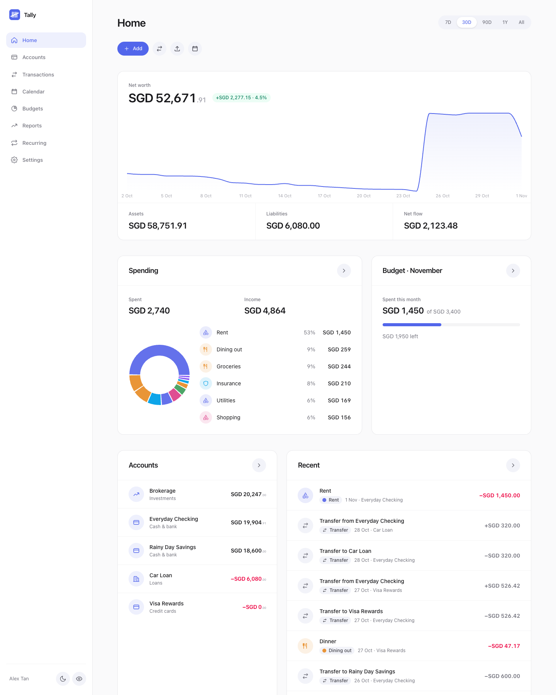
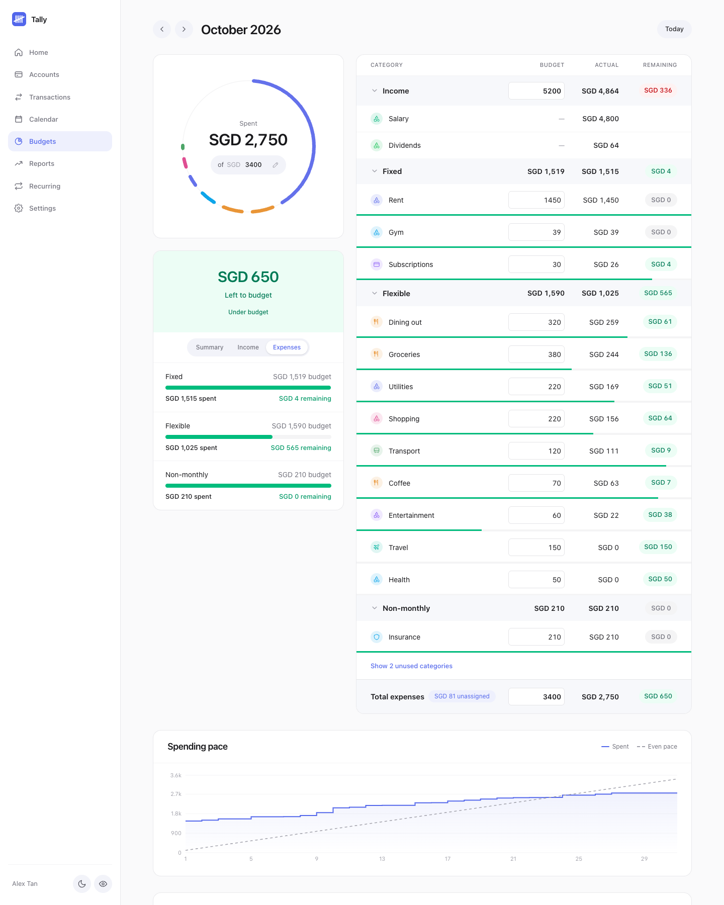
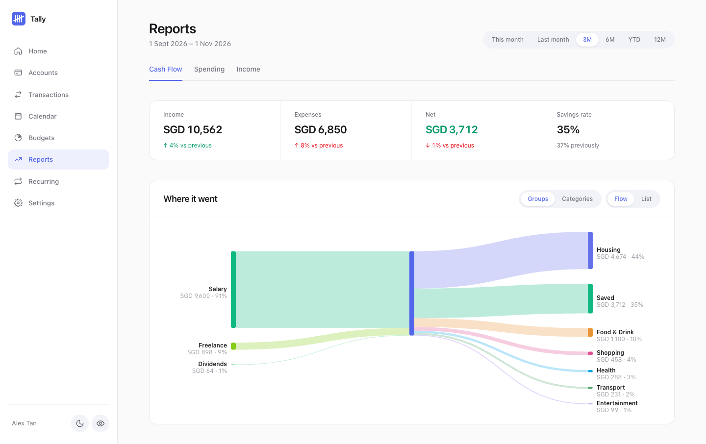
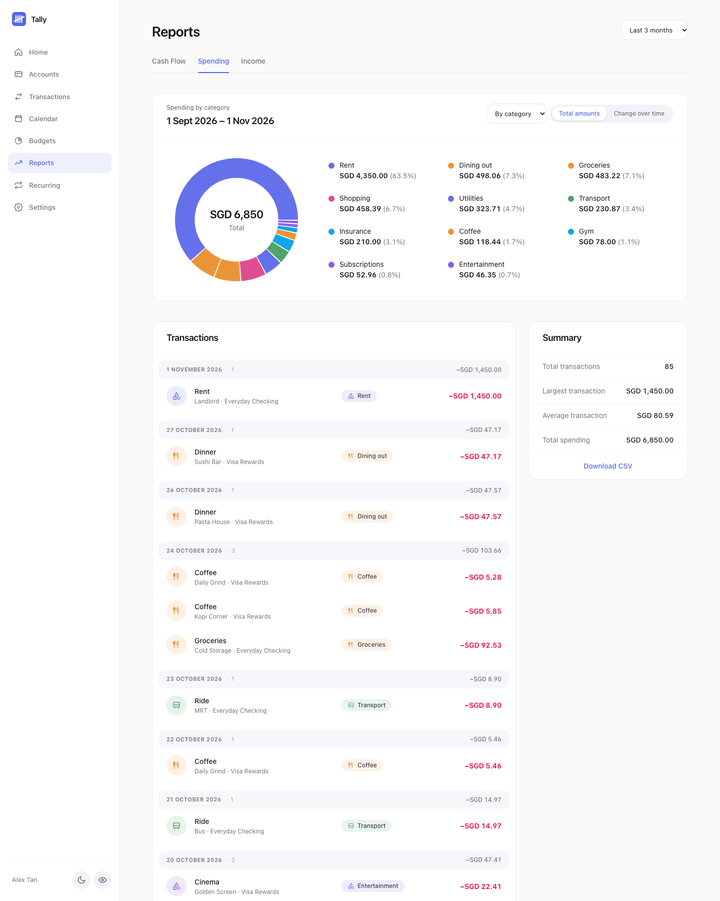
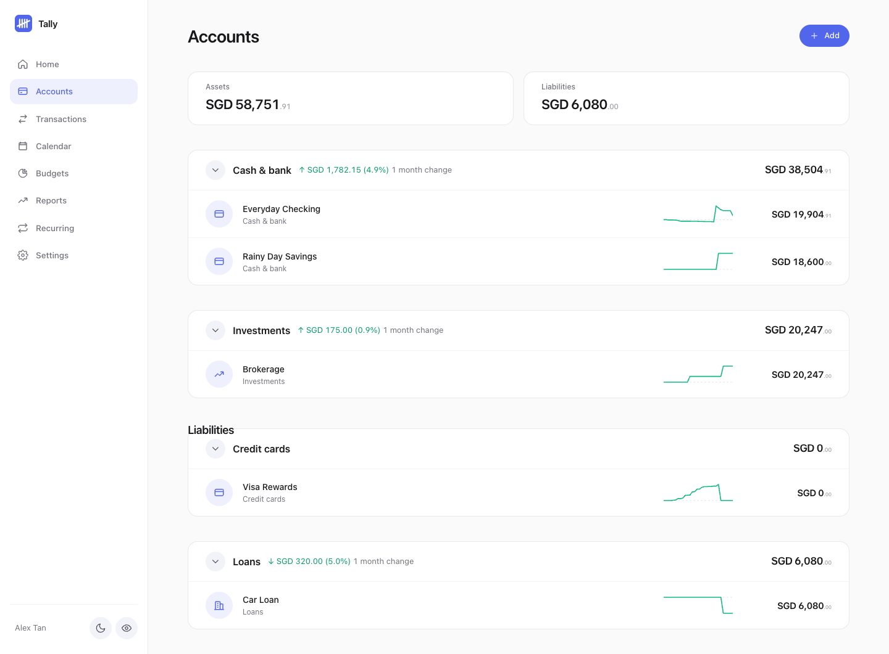
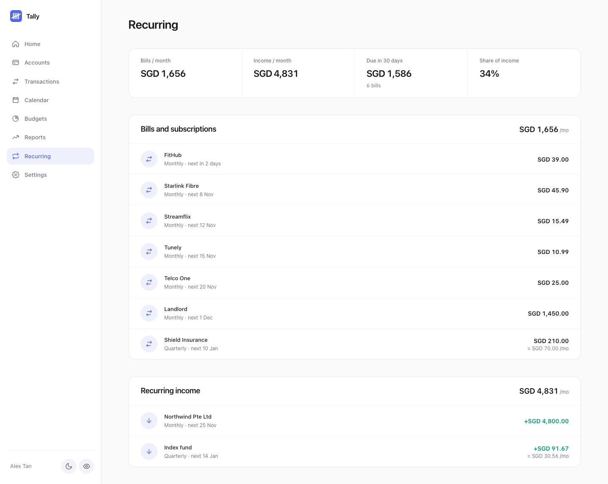
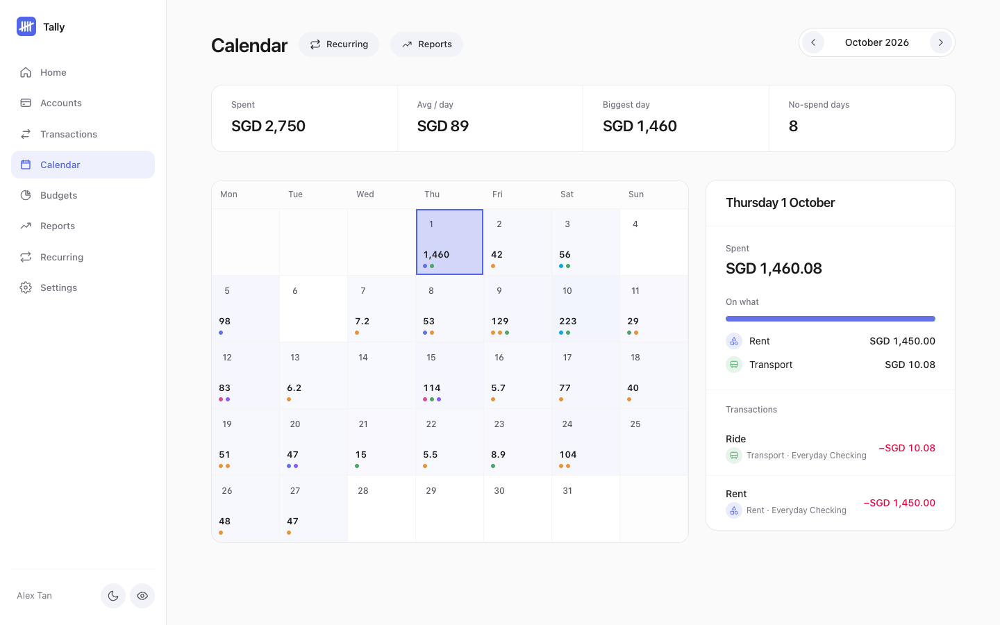
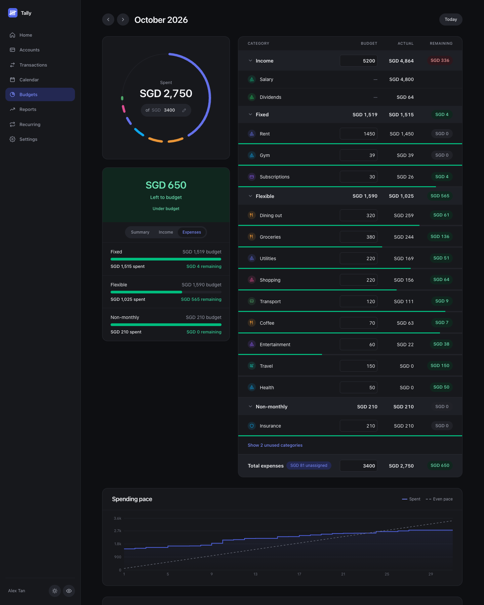
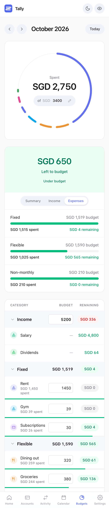

<p align="center"></p>

# Tally

Tally is a slimmed-down, single-user rewrite of [Maybe Finance](https://github.com/maybe-finance/maybe) as a plain web app with a minimal light UI:

- **Backend:** Fastify 5 + TypeScript, raw SQL via `pg`, Zod validation
- **Frontend:** React 19 + Vite + TypeScript, TanStack Query, Tailwind v4, Recharts
- **Database:** your existing Maybe Postgres database, used **as is**. There are no migrations and no data conversion: it reads and writes the original Rails tables (`accounts`, `account_entries`, `account_balances`, `budgets`, ...), so a `pg_dump` from the old app drops straight in.



<details>
<summary>More screenshots</summary>

| | |
|---|---|
| **Budget** (Fixed / Flexible / Non-monthly) | **Cash flow** |
|  |  |
| **Spending report** | **Accounts** |
|  |  |
| **Recurring** | **Calendar** |
|  |  |
| **Dark mode** | **Phone** |
|  |  |

</details>

The screenshots use made-up data (`scripts/demo-seed.mjs`), not real accounts.

## Run it

```bash
npm install
npm run db:local:init                                    # a private Postgres in ~/.maybe-lite (needs: brew install postgresql@17)
npm run db:import -- "/path/to/maybe_2026-10-31_1049.dump"   # load your Maybe data
npm run dev                                              # API on :3001, web on :5173 (proxied)
# or production: npm run build && npm start              # everything on :3001
```

Other ways to host the database (Docker, a hosted Postgres), automatic backups to another folder, and
restores are covered in **[docs/DATABASE.md](docs/DATABASE.md)**. Quick reference:

| | |
|---|---|
| `npm run db:backup` | verified, dated backup (+ optional mirror folder, rotation) |
| `npm run db:backups` | list backups |
| `npm run db:restore -- <file>` | restore (takes a safety backup first) |
| `npm run db:backup:schedule -- install 02:30` | daily automatic backups |

Running it on a server (a Raspberry Pi behind a reverse proxy, with automatic updates from GitHub) is covered in **[docs/SELF-HOSTING.md](docs/SELF-HOSTING.md)**.

There is **no login**: the app acts as the first user/family in your database, so your existing data just appears. Because anyone who can reach the server can read and change everything, it listens on `127.0.0.1` only by default. Don't expose it to a network (`HOST=0.0.0.0`) unless you put your own access control in front of it.

## What's in

| Area | What you can do |
|---|---|
| **Accounts** | All 9 account types (cash, investment, crypto, property, vehicle, other asset, credit card, loan, other liability), grouped into collapsible cards per type with a 30-day change and a sparkline per account. Multi-currency with conversion to your home currency using the `exchange_rates` already in your data. Disable / rename / delete. **Rebalance** forces an account's balance to a given amount (to match a statement or an investment app). |
| **Transactions** | Search, filter (account, category, tag, type, dates), pagination, create / edit / delete, merchants, tags, notes, "exclude from reports", bulk recategorize / delete. |
| **Transfers** | Create transfers between accounts (Transfer button on Home, Accounts, Transactions and each account; it can start from the account you are on, and handles two currencies); confirm or reject the auto-detected "pending" transfers already in your data. Transfers are excluded from spending/income. |
| **Budgets** | A Budget / Actual / Remaining table for the month (click any amount to edit). Expenses are split into **Fixed**, **Flexible** and **Non-monthly** automatically, based on the recurring bills found in your history. Each category has a remaining pill and a progress line (red when over). Also: a segmented ring of spent vs. budget, a "Left to budget" card with Summary / Income / Expenses tabs, a spending-pace chart against an even-spend line, a daily allowance, projected month-end spend, income vs. expected, unused categories folded away, and a 12-month history. A new month starts as a copy of the previous one. |
| **Calendar** | A month grid showing how much you spent each day, with category dots for *what* it went on and a heat tint for bigger days. Click a day for its category breakdown and every transaction. Monthly total, daily average, biggest day, no-spend days. Upcoming recurring bills are marked on their due dates. |
| **Recurring** | Finds repeating bills, subscriptions and income (weekly to yearly) from your transaction history: monthly totals, what is due in the next 30 days, per-item history, and a "not recurring" button (remembered in the browser). Nothing is stored; it is recomputed from your transactions. |
| **Reports** | Three tabs. **Cash Flow:** income vs. spending as a Sankey diagram (income sources, the spending groups or categories they fed, and what was saved), with savings rate and a comparison with the previous period; a list view on phones. **Spending** and **Income:** by category, merchant or tag, as a donut with a legend or as a month-by-month stacked chart, a transaction list that follows the slice you click, a summary card and *Download CSV*. |
| **Suggestions** | The transaction form offers the category used for the same description before, CSV import can fill uncategorized rows the same way, and Transactions has a *Needs review* shortcut. |
| **Import** | Upload (or paste) a bank CSV, match columns, preview, import. See below. |
| **Privacy** | The eye button (sidebar on desktop, top bar on phones) hides every amount in the app, including charts, the calendar and editable budget fields. The choice is remembered in the browser. |
| **Home** | Net-worth chart (7D-All), assets vs. liabilities, cash flow, spending by category, budget progress, recent activity. |
| **Categories** | Manage categories, merchants and tags. |

## CSV import

Pick the account, upload the file, and check the column mapping (guessed from the headers). Nothing is written until you press Import, and the review step shows what will happen first.

- Handles quoted fields, `,` `;` tab and `|` delimiters, BOMs, `1,234.56` and `1.234,56`, `(12.50)` and `12.50-` negatives, currency symbols.
- One **Amount** column (choose whether spending is negative or positive in your file) or separate **Debit / Credit** columns.
- Date formats: ISO, `5 Jan 2026`, and `DD/MM/YYYY` or `MM/DD/YYYY`. It infers which when any value disambiguates (e.g. `13/05`), and otherwise asks you to choose rather than guessing.
- **Duplicates** already in the account (same date, amount and description) are skipped, so re-importing an overlapping statement is safe. Genuine repeats within one file are kept.
- Optional Category and Notes columns; unknown categories can be created automatically.
- Bad rows are skipped and listed with line numbers.

## Compatibility notes (things worth knowing)

These were reverse-engineered from your data and verified against it:

- **Sign convention:** an entry `amount > 0` is an outflow (expense, or more debt on a liability); `< 0` is an inflow.
- **Balances:** `account_balances` is rebuilt exactly like the original app did. The series starts at 0 the day *before* an account's first entry. Each day subtracts outflows (adds, for liabilities). A *valuation* entry resets the running balance to its value. Excluded entries still count toward balances. Recomputing every account from your dump reproduces all 3,831 stored rows, and create -> edit -> delete round-trips leave them byte-identical.
- **Because valuations are anchors,** a transaction dated *before* an account's latest Rebalance won't change today's balance. This matches the original behaviour.
- `accounts.classification` is a generated column in the schema, so it is never written.
- An account's current balance is its balance **as of today**: future-dated entries show on the calendar and in the daily series but don't change it yet.
- The app never touches tables for features that were removed, so nothing there is modified or deleted.

## Deliberately left out

Features that were unfinished, or depend on paid/third-party services:
Plaid bank sync, Stripe billing, the AI assistant / chats, data enrichment (Synth API), user accounts / login / invitations / multi-user families, impersonation, two-factor auth, security price & exchange-rate syncing, and trade entry / holdings recalculation.

Investment **holdings and trades already in your data are shown read-only**; balances for those accounts are driven by Rebalance. `exchange_rates` in your dump stops at 2025-07-23, so USD amounts use the nearest rate on/before each date (falling back to the nearest after). Add newer rows to that table (or wire up a rate source) to keep conversions current.

## Layout

```
server/src/   index.ts, owner.ts, db.ts, csv.ts, balances.ts (balance recompute), fx.ts (SQL conversion),
              recurring.ts (bill detection), suggest.ts (category suggestions), routes/*
web/src/      App.tsx, pages/*, components/*, ranges.ts (date ranges)
scripts/      itest.mjs, import.itest.mjs (API integration tests; run against a COPY of your DB),
              csv.test.ts, recurring.test.ts (unit tests), db/* (backup and restore),
              demo-seed.mjs, screenshots.mjs (made-up data and the README screenshots)
deploy/       compose.pi.yml, core-postgres.yml, update.sh (see docs/SELF-HOSTING.md)
docs/         DATABASE.md, SELF-HOSTING.md
.github/      workflows/image.yml (builds the Docker image)
```

Checks: `npm run typecheck` (both packages), `npx tsx scripts/csv.test.ts`, `npx tsx scripts/recurring.test.ts`.

## Contributing, security, license

See [CONTRIBUTING.md](CONTRIBUTING.md) for setup, the demo data and the checks to run, and [SECURITY.md](SECURITY.md) before hosting it anywhere (there is no login). Tally is released under the [MIT License](LICENSE). It is an independent project and not affiliated with Maybe Finance.

## Deploying

Push to `main` and GitHub builds a Docker image (arm64, for the Pi) and publishes it to `ghcr.io/<owner>/tally`. A cron script on the server pulls it, backs up the database, restarts the app and rolls back if it doesn't come up healthy. Setup and day-to-day commands are in [docs/SELF-HOSTING.md](docs/SELF-HOSTING.md).
